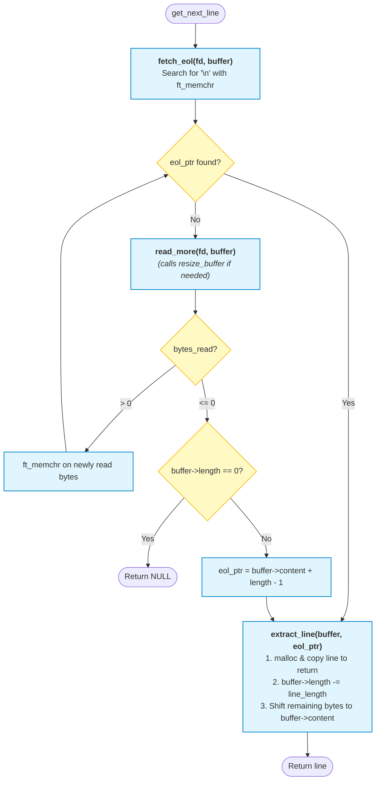

*This project has been created as part of the 42 curriculum by lwicket.*

## ℹ️ Project Overview

> [!WARNING]
> This project is still a work in progress. Its contents, along with the information in this README file, are subject to change.

✨ 𝑔𝑒𝓉_𝓃𝑒𝓍𝓉_𝓁𝒾𝓃𝑒 ✨ is one of the first projects at [42 School](https://www.42network.org/). It consists of reimplementing a function similar to the POSIX [`getline(3p)`](https://pubs.opengroup.org/onlinepubs/9799919799/functions/getline.html) function, that is, a function that retrieves the next line from a given stream. It must be written in C on top of [`read(2)`](https://sites.uclouvain.be/SystInfo/manpages/man2/read.2.html) and [`malloc(3)` and `free(3)`](https://sites.uclouvain.be/SystInfo/manpages/man3/malloc.3.html). No other functions are allowed.

The stated objective is to get the student to learn the concept of [static local variables](https://en.wikipedia.org/wiki/Local_variable#Static_local_variables), but it's also a great opportunity to dive into buffering and file handling in C.

The constraint that makes the project interesting is that it has to work with a read buffer of arbitrary size, defined at compile time through a macro (`BUFFER_SIZE`). Because of that, the easy but slow way of reading the stream byte by byte until a newline is found is out of the question. It means we have to come up with solutions to handle the leftover bytes following a longer-than-one-line read, and reads that don't contain enough bytes to make a line.

Using [`lseek(2)`](https://sites.uclouvain.be/SystInfo/manpages/man2/lseek.2.html) or loading the whole file in memory is forbidden.


### Bonus Task

This project comes with an extra task for extra-motivated students.

The mandatory part of the assignment only asks you to make `get_next_line` work assuming there would only ever be one file being read at a time.

For the bonus part, `get_next_line` must be able to handle multiple files. This means we can't simply have one static buffer for all the leftover bytes: we need one buffer per file being read.

## 🛠️ Compilation & Usage

> [!WARNING]
> The I/O for this project is implemented on top of UNIX syscalls, which means you will need a UNIX-like system (such as Linux or macOS) to compile and run it.

> [!NOTE]
> The project is structured as per the assignment. It is not ready to use as is. This section itself is only there because the assignment requires it.

### Requirements

- [GCC](https://gcc.gnu.org/) or [Clang](https://clang.llvm.org/)
- [C99](https://en.cppreference.com/c/99) support
- A UNIX-like system (such as Linux or macOS)

### Compilation

`get_next_line` doesn't feature a Makefile. You have to compile it yourself:

```shell
cc -c get_next_line_bonus.c get_next_line_utils_bonus.c -I.
```

Or update `-I.` to `-I<whatever path you put the .h files in>`.

Optionally, you can overwrite the size of the read buffer with `-DBUFFER_SIZE=`:

```shell
cc -c get_next_line_bonus.c get_next_line_utils_bonus.c -I. -DBUFFER_SIZE=128
```

> [!TIP]
> In case you don't provide a buffer size, it defaults to 128.

The resulting object files can then be linked into a binary the normal way.

### Example usage

```c
#include "get_next_line_bonus.h"
#include <fcntl.h>
#include <stdio.h>
#include <stdlib.h>
#include <unistd.h>

/**
 * Print the script of Bee Movie line by line.
 */
int main(void)
{
    char *line = NULL;
    int file = open("bee-movie.txt", O_RDONLY);

    while ((line = get_next_line(file))) {
        puts(line);
        free(line);
    }

    close(file);
}
```

> [!WARNING]
> Be sure to read the file to the end so that `get_next_line` can reset its internal state and release resources.

## 📋 Coding Style

My coding style conforms to the [Norm](./norm.en.pdf), a set of strict styling guidelines enforced for all C exercises, which all students must follow under penalty of a zero grade.

Beyond purely cosmetic considerations, the Norm also forbids the following language constructs:

- `for` loops
- `do … while` loops
- `switch` statements
- `goto`
- the ternary operator
- declarations with initialization
- assignments inside controlling expressions

(non-exhaustive list)

> [!TIP]
> You can find the latest version of the Norm in the [Norminette repository](https://github.com/42School/norminette) – the program used to check conformity with the Norm. The version of the Norm included in this repository is the one that was in use when I completed this project.

## 🔬 Implementation Notes

My implementation differs from the approach usually taken by 42 students to solve this exercise.

The main constraint of `get_next_line` is that it must read the file using a buffer of an arbitrary size that is fixed at compile-time. This buffer may be too large or too small for the size of the line that `get_next_line` must read, so a second buffer is necessary to hold the bytes waiting to be processed. These bytes exist either because the read was insufficient to reach the end of the line, or because we read more than necessary and must keep the extra bytes in memory to construct subsequent lines.

### `ft_strjoin` considered harmful

In most student implementations, the handling of that second buffer is the main avenue for improvement. Often, students simply read the file in a loop until the end of the line is found. Each time they read, they append the newly read bytes to their processing buffer using "`ft_strjoin`" (a utility to concatenate two strings and allocate memory for the result), replacing the old buffer altogether with the new one. Because of this single design choice:
- Every single read triggers a malloc.
- Every single read triggers a free.
- Every single read triggers a strcpy.

This is really bad news for performance. Not only is a malloc costly by itself, but repeated memory allocations and deallocations drastically increase the risk of [memory fragmentation](https://en.wikipedia.org/wiki/Fragmentation_(computing)#Memory).

### Dynamic Array

The solution to the problem above is straightforward: instead of reallocating the buffer on every read, I try to reuse the same buffer for every line.

In other words, I want a buffer that is big enough to hold a line without having to reallocate, but not so big that it wastes memory. To achieve this, I implemented a data structure known as a [dynamic array](https://en.wikipedia.org/wiki/Dynamic_array). 

A dynamic array is just like a regular array, except that it can grow in size. Instead of having just enough room for its content, it reserves a little extra space, so that appending something else doesn't immediately result in a costly reallocation. When its maximum capacity is reached, it reallocates, but once again with a little extra room. The goal is for the array to eventually reach a sweet spot where it is large enough to hold any line without wasting too much memory.

I start with a small size that I expect to be sufficient to hold a line (in this case, `BUFFER_SIZE`, since the buffer has to be at least that large). Whenever the length of the line outgrows the buffer's capacity, I reallocate the buffer to make it bigger, using a growth factor of 1.5.

Key benefits of this approach:
- `get_next_line` never reallocates memory if the current buffer size is big enough.
- If it isn't big enough, the optimal size is reached in logarithmic time.
- Memory fragmentation is kept to a minimum. The growth factor of 1.5 (instead of 2) allows the allocator to reuse previously freed memory<sup>1</sup>, which improves cache locality.
- I know the exact size of the buffer at any moment, allowing me to use highly optimized memory functions instead of slower string functions. This also permits reading binary files without making any changes to the logic.

Below are the results I get when feeding an entire book to my get_next_line:
```
BUFFER_SIZE=128: buffer resized 2 times, final size of 288 bytes
BUFFER_SIZE=1:   buffer resized 11 times, final size of 94 bytes
BUFFER_SIZE=8:   buffer resized 5 times, final size of 81 bytes
BUFFER_SIZE=150: buffer resized 1 time, final size of 225 bytes
BUFFER_SIZE=64:  buffer resized 2 times, final size of 144 bytes
```

We went from one guaranteed allocation per read with the `ft_strjoin` approach to only a couple of mallocs *for reading an entire book*!

### Are we super fast yet?

No. By using a dynamic array for the read buffer, we have eliminated one big bottleneck, but it is still not enough. Unfortunately, I don't believe it is possible to do much better within the constraints of the assignment... because the next bottleneck comes from the way `get_next_line` is specified in the assignment itself. No matter how clever the underlying implementation is, `get_next_line` requires you to allocate a new string for each line, without any way to reuse a preexisting buffer.

If we really wanted to make `get_next_line` fast, we'd have to change its API too, to allow reusing the same buffer across calls. That's what the POSIX [`getline(3p)`](https://pubs.opengroup.org/onlinepubs/9799919799/functions/getline.html) function does: it allows you to provide a pointer to a malloced buffer for the result, which the function can reallocate as needed.

### A picture is worth a thousand words

`get_next_line` is a project that requires a certain amount of coding discipline. Its control flow can be a bit intricate, so jumping straight into the code can be challenging. Sketching out a diagram of the different execution paths beforehand helped me a lot.

For reference, here's the flowchart corresponding to my implementation:



Many thanks to fellow student [Elyass Shinwari](https://github.com/ElyassShinwari) who shared a similar diagram on Slack, from who I shamelessly stole the idea<sup>2</sup>!

### Compile-time buffer size validation

My implementation uses preprocessor directives to ensure that the provided `BUFFER_SIZE` is strictly greater than 0 and smaller than 2,147,479,552. If it isn't, the preprocessor emits an error and compilation stops.

A buffer size of 0 would make the `get_next_line` function completely unusable, as any program relying on it wouldn't be able to read anything.

My stance is to catch defects as early as possible, especially in situations where recovery isn't possible. With that in mind, preventing compilation altogether when the buffer size is 0 is the best approach.

As for the upper bound of 2,147,479,552, it's mainly there to enforce a limit. I picked that number because it corresponds to the Linux kernel's maximum number of bytes per read (0x7ffff000). A buffer size larger than that would simply waste memory, as the kernel won't allow you to read more than that in a single call anyway.

I'm just a bit worried that the Moulinette (42's autograder) might try to compile the project with a buffer size of 0 and interpret the compilation failure as me not handling the edge case correctly. <sub><sup>Perhaps I'll chicken out and remove that preprocessor check from the final version I turn in.</sup></sub>

## 📚 References & Acknowledgments

1. [Facebook's vector implementation](https://github.com/facebook/folly/blob/main/folly/docs/FBVector.md#memory-handling): on growth factors smaller than the golden ratio allowing for memory reuse
2. [eshinwar's own `get_next_line` repository](https://github.com/ElyassShinwari/Get-Next-Line): for the idea of including a flowchart

### AI Usage

- 🚫 **Code**: The whole code has been handcrafted with love by yours truly.
- 🚫 **Writing**: I used AI to proofread my README as I was writing it, but I didn't have it generate any of the content either. I've been increasingly stern about the AI keeping my tone and style, only fixing my grammar and *overly* unnatural wording ("overly" is its own addition by the way; I guess it's its way of signifying that my English is beyond repair lol)
- ✅ **Diagram**: The cool flowchart above has been generated by AI based on my code.
